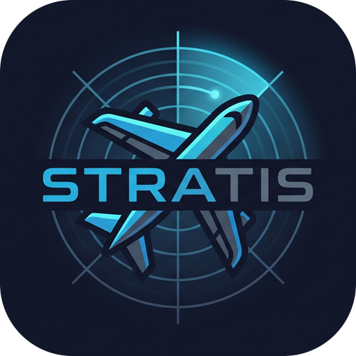

# Stratis

**Planeador de voo tático, lobby AWACS/C2 e replay para DCS World e MSFS**: planeie a missão no mapa, veja as aeronaves da sala em tempo real e grave o voo para a revisão.

 

  

O botão descarrega sempre a versão mais recente · <a href="https://github.com/Thiago-Bilangieri/stratis-releases/releases">todas as versões e novidades</a>

---

## Requisitos

- Windows 10 ou 11 (64 bits)
- DCS World **ou** Microsoft Flight Simulator 2020/2024 (o simulador é escolhido ao abrir o Stratis)
- Ligação à internet para o lobby e para carregar o mapa e o relevo pela primeira vez (o planeador funciona offline depois de a zona estar em cache)

Não é preciso instalar mais nada: o .NET já vem incluído. O mapa usa o Microsoft Edge WebView2, que já vem no Windows 11 e no Windows 10 atualizado.

## Instalação passo a passo

### 1. Descarregue o instalador

Clique no botão **DESCARREGAR O STRATIS** acima. O ficheiro chama-se `StratisApp-win-Setup.exe`.

> **O navegador avisou que o ficheiro "não é transferido com frequência"?** É normal em aplicações novas.
> No **Edge**: passe o rato sobre a transferência → **⋯** → **Manter** → **Mostrar mais** → **Manter mesmo assim**.
> No **Chrome**: clique em **Manter** (ou **Transferir ficheiro suspeito → Transferir mesmo assim**).

### 2. Abra o instalador e libere no SmartScreen

Na primeira vez, o Windows mostra um ecrã azul a dizer **"O Windows protegeu o seu PC"**. Isto acontece porque o Stratis ainda não tem assinatura digital paga e o Windows não o conhece. **Não é um vírus.**

Clique em **Mais informações** e depois em **Executar mesmo assim**.

### 3. Pronto

A instalação é automática, demora alguns segundos e **não pede palavra-passe de administrador**. O Stratis abre sozinho no fim e cria um atalho no **ambiente de trabalho** e no **menu Iniciar**.

O aviso do SmartScreen só aparece nesta primeira instalação: as atualizações não passam por ele.

## Atualizações automáticas

Não precisa de descarregar de novo. Sempre que o Stratis abre, verifica se há uma versão nova e, se houver, **descarrega e reinicia já atualizado** antes de mostrar a aplicação. A janela mostra o progresso, normalmente em poucos segundos.

Sem internet, abre normalmente na versão que já tem.

As novidades de cada versão ficam na [página de versões](https://github.com/Thiago-Bilangieri/stratis-releases/releases).

## Primeiros passos

1. **Abra o Stratis** e escolha o simulador (DCS ou MSFS). A escolha é pedida em cada arranque.
2. **Planeador**: marque os pontos no mapa, indique a performance da aeronave e exporte para `.pln` (MSFS) ou `.miz` (DCS).
3. **Lobby**: o comandante cria uma sala (ID do esquadrão + PIN) e os pilotos entram com esses dados. Todos veem as aeronaves no mapa em tempo real.
4. **Replay**: o comandante grava a sala e o ficheiro fica guardado no seu PC, para rever depois na linha do tempo.

No DCS, instale o script de telemetria pelo botão da própria aplicação e reinicie o DCS.

## Desinstalar

**Definições do Windows → Aplicações → Aplicações instaladas → Stratis → Desinstalar.**

## Problemas?

- **Sem aeronave no mapa (DCS)**: instale o script de telemetria na aplicação e reinicie o DCS.
- **O mapa não aparece**: instale o [Microsoft Edge WebView2 Runtime](https://developer.microsoft.com/microsoft-edge/webview2/).
- **Tempo real desligado no lobby**: verifique a ligação à internet; a ligação volta a tentar sozinha.
- Outros problemas: envie o ficheiro de diagnóstico do dia, que fica em `%LocalAppData%\Stratis\logs\` (cole este endereço na barra do Explorador de Ficheiros).
